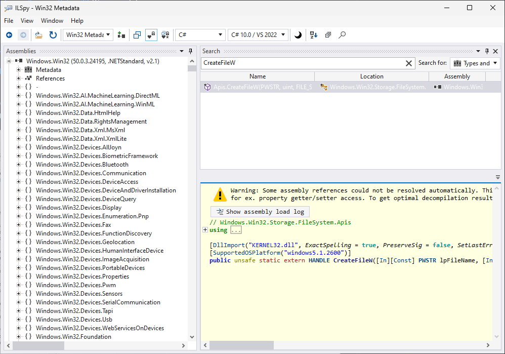

# Overview

Win32 APIs provide functionality that not all languages and frameworks support themselves. When developing for Windows, developers often call into Win32 APIs to access this functionality.

Historically, this has required manually [redefining the APIs](http://pinvoke.net/) to make them accessible, which is fragile and error-prone. Community projects like https://github.com/dotnet/pinvoke (.NET) and https://github.com/retep998/winapi-rs (Rust) have taken on the burden of providing strongly-typed and validated API signatures for their frameworks, but the projects are manually maintained, which is hard to sustain and makes it challenging to provide thorough API coverage.

This project aims to provide metadata for Win32 APIs such that idiomatic [projections](./docs/projections.md) and projects like the ones above can be generated for all languages and frameworks in a more automated way and with more complete API coverage.

To call Win32 APIs from the language of your choice based off of this metadata, use the following [language projections](./docs/projections.md):

* C# - https://github.com/microsoft/cswin32 (Microsoft)
* Rust - https://github.com/microsoft/windows-rs (Microsoft)
---
* Beef - https://github.com/jayrulez/Win32-Beef (Community)
* D - https://github.com/rumbu13/windows-d (Community)
* Dart - https://github.com/halildurmus/win32 (Community)
* Python - https://github.com/ynkdir/py-win32more (Community)
* Zig - https://github.com/marlersoft/zigwin32 (Community)
* .NET Standard - https://github.com/Lamparter/Win32 (Community)

Note: Community projects are listed here to help with discovery but are not officially validated by Microsoft.

See the [roadmap](./docs/roadmap.md) and [FAQ](./docs/faq.md) for more details.

If you'd like to browse the metadata to see what we're emitting, extract Windows.Win32.winmd from the [Microsoft.Windows.SDK.Win32Metadata](https://www.nuget.org/packages/Microsoft.Windows.SDK.Win32Metadata/) NuGet package and load Windows.Win32.winmd in [ILSpy](https://github.com/icsharpcode/ILSpy/releases/latest). Download the package and rename it to .zip to browse and extract its content.



# Principles

Below are some principles that guide the metadata that we produce:

* Provide the broadest API coverage possible
* Keep the names of the original APIs, but express in metadata additional information that can make them easier to use. 
* Convert non-specific types like `uint` that use constants into explicit enums to improve usability and discoverability. Keep enum member names consistent with the original constant names to preserve SEO.
* Express Win32 typedefs like `HANDLE` and `GDI` objects as strongly-typed structs. The definition of these structs include how to dispose of the resources (like `CloseHandle` or `DeleteObject`). It is up to language projections to make use of this information in a language-specific way. For example, a C# projection could use `SafeHandle` objects for `HANDLE` and `GDI` objects.

# Architecture

See [ARCHITECTURE.md](docs/architecture.md).

# Projections

See [PROJECTIONS.md](docs/projections.md).

# Contributing

See [CONTRIBUTING.md](./CONTRIBUTING.md).

# Licensing

## WinmdGenerator native runtime dependencies

`Microsoft.Windows.WinmdGenerator` bundles x64 Visual C++ runtime DLLs beside
`libclang.dll` and `libClangSharp.dll` in `tools\net10.0\win-x64`. Consumers do not
need to update the machine-wide VC runtime or adjust `PATH` for these dependencies.
The runtime architecture matches the scraper host, not the generated metadata.

Packing `sources\GeneratorSdk\nuget\BuildSdk.proj` requires an x64 Visual Studio
redistributable at least as new as the native libraries' recorded linker versions.
The packaging step uses `VCToolsRedistDir` when set, otherwise the default
redistributable of the Visual Studio installation selected by `scripts\Get-VSPath.ps1`.
It packages all DLLs from that installation's `x64\Microsoft.VC*.CRT` directory,
including the companion STL runtime libraries, and rejects missing, non-x64, or
older files. It does not copy DLLs from the compiler directory or System32,
and it does not bundle the Windows-provided UCRT.

To select a particular installed redistributable, pass its CRT directory:

```powershell
dotnet pack sources\GeneratorSdk\nuget\BuildSdk.proj -c Release `
    "-p:VcRuntimeDirectory=C:\Program Files\Microsoft Visual Studio\18\Enterprise\VC\Redist\MSVC\<version>\x64\Microsoft.VC145.CRT"
```

With the current Clang binaries, packaging agents need a 14.50 or newer
redistributable; an older VS 2022 installation alone is insufficient. The recorded
linker version is a packaging guard, not a definitive determination of the
minimum runtime supported by every native code path. Keep the selected runtime
compatible with the native dependencies' actual build toolchain.

Windows CI and release jobs use `windows-2025-vs2026`. Native samples and test
fixtures use the VS 2026 `v145` toolset; local VS discovery requires VS 2026.
Package-backed
[integration tests](CONTRIBUTING.md#winmdgenerator-package-integration-tests)
restore the just-built SDK from an isolated local feed and exercise its normal
MSBuild pipeline.

Package maintainers are responsible for updating the bundled app-local VC
runtime libraries, which are not serviced by Windows Update.

## MIT
* All metadata assemblies (e.g. `Windows.Win32.winmd`)
* All tooling in this repository and in the [Microsoft.Windows.SDK.Win32Metadata NuGet package](https://www.nuget.org/packages/Microsoft.Windows.SDK.Win32Metadata/)

## Windows SDK
* All Windows headers (e.g. RecompiledIdlHeaders) and Interface Definition Language (IDL) files in this repository and in the aforementioned NuGet package.

# Trademarks

This project may contain trademarks or logos for projects, products, or services. Authorized use of Microsoft trademarks or logos is subject to and must follow Microsoft's Trademark & Brand Guidelines. Use of Microsoft trademarks or logos in modified versions of this project must not cause confusion or imply Microsoft sponsorship. Any use of third-party trademarks or logos are subject to those third-party's policies.
