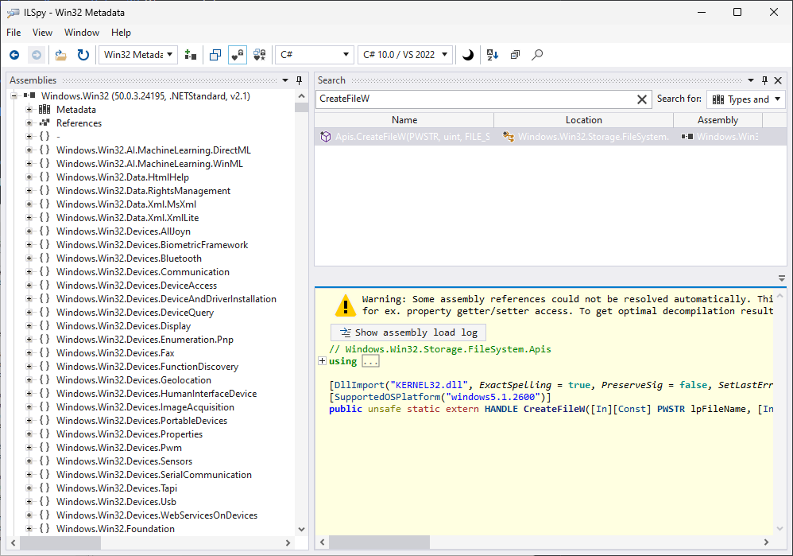

# Overview

Win32 APIs provide functionality that not all languages and frameworks support themselves. When developing for Windows, developers often call into Win32 APIs to access this functionality.

Historically, this has required manually [redefining the APIs](http://pinvoke.net/) to make them accessible, which is fragile and error-prone. Community projects like https://github.com/dotnet/pinvoke (.NET) and https://github.com/retep998/winapi-rs (Rust) have taken on the burden of providing strongly-typed and validated API signatures for their frameworks, but the projects are manually maintained, which is hard to sustain and makes it challenging to provide thorough API coverage.

This project aims to provide metadata for Win32 APIs such that idiomatic [projections](./docs/projections.md) and projects like the ones above can be generated for all languages and frameworks in a more automated way and with more complete API coverage.

To call Win32 APIs from the language of your choice based off of this metadata, use the following [language projections](./docs/projections.md):

* C# - https://github.com/microsoft/cswin32 (Microsoft)
* Rust - https://github.com/microsoft/windows-rs (Microsoft)
---
* Beef - https://github.com/jayrulez/Win32-Beef (Community)
* D - https://github.com/rumbu13/windows-d (Community)
* Dart - https://github.com/halildurmus/win32 (Community)
* Python - https://github.com/ynkdir/py-win32more (Community)
* Zig - https://github.com/marlersoft/zigwin32 (Community)
* .NET Standard - https://github.com/Lamparter/Win32 (Community)

Note: Community projects are listed here to help with discovery but are not officially validated by Microsoft.

See the [roadmap](./docs/roadmap.md) and [FAQ](./docs/faq.md) for more details.

If you'd like to browse the metadata to see what we're emitting, extract Windows.Win32.winmd from the [Microsoft.Windows.SDK.Win32Metadata](https://www.nuget.org/packages/Microsoft.Windows.SDK.Win32Metadata/) NuGet package and load Windows.Win32.winmd in [ILSpy](https://github.com/icsharpcode/ILSpy/releases/latest). Download the package and rename it to .zip to browse and extract its content.



# Principles

Below are some principles that guide the metadata that we produce:

* Provide the broadest API coverage possible
* Keep the names of the original APIs, but express in metadata additional information that can make them easier to use. 
* Convert non-specific types like `uint` that use constants into explicit enums to improve usability and discoverability. Keep enum member names consistent with the original constant names to preserve SEO.
* Express Win32 typedefs like `HANDLE` and `GDI` objects as strongly-typed structs. The definition of these structs include how to dispose of the resources (like `CloseHandle` or `DeleteObject`). It is up to language projections to make use of this information in a language-specific way. For example, a C# projection could use `SafeHandle` objects for `HANDLE` and `GDI` objects.

# Architecture

See [ARCHITECTURE.md](docs/architecture.md).

## Namespace outputs

The emitter defaults to one output. `--namespaceOutput Namespace=Additional.winmd`
routes that namespace, its descendant namespaces, and all nested types to an
additional output. Matching is ordinal and uses whole namespace segments;
overlapping routes are rejected. The complete source set is prepared and compiled
once, then each output is emitted from that semantic model with assembly-scoped
references to types owned by the other outputs. File names are metadata assembly
identities, including `.winmd`; all outputs share the configured assembly version.

GeneratorSdk projects can configure the same routing with MSBuild items:

```xml
<NamespaceOutput Include="Windows.Win32.Graphics.Direct3D12">
  <OutputWinmd>..\..\bin\Microsoft.Direct3D.D3D12.winmd</OutputWinmd>
</NamespaceOutput>
```

The WinSDK project enables that route while retaining its Windows
SDK headers and annotations. `EmitDirect3D12Separately=false` restores monolithic
WinSDK emission for comparison. The package includes both baseline files, and
projection inputs select the packaged D3D12 baseline by default. A compatible
replacement package sets `Direct3D12ProjectionMetadataPath` instead of adding a
second D3D input. Video/Media Foundation, Windows integration, common D3D, and DXGI
remain Windows-owned; canonical namespaces do not change.

Both metadata identities use assembly version `1.0.0.0`
(`WinmdAssemblyVersion`), independently of the NuGet release version.
Replacement producers must use that identity and satisfy
the selected Windows baseline's minimum type/signature surface. Emission rejects
input references whose reciprocal dependencies require a different output
version, culture, or public key. Existing Agility
enum-name omissions and evolving sentinel values still require an explicit
compatibility decision. Consumers must resolve both metadata files; older
single-file or external-COM-unaware projection tooling needs updating.

The repository's integrity checks inspect both baseline files. Delegate checks
accept `--ref` metadata paths so COM ancestry and delegate dependencies resolve
across the output boundary. Namespace-cycle checks remain file-local and are not
cross-assembly validation.

`WinmdUtils dump --includeReferencedWinmds` compares the combined surface,
following `.winmd` assembly references beside the input and rejecting missing or
mismatched providers. The local baseline diff and CI API diff use this option;
CI publishes and signs both metadata files.

# Projections

See [PROJECTIONS.md](docs/projections.md).

# Contributing

See [CONTRIBUTING.md](./CONTRIBUTING.md).

# Licensing

## MIT
* All metadata assemblies (e.g. `Windows.Win32.winmd`)
* All tooling in this repository and in the [Microsoft.Windows.SDK.Win32Metadata NuGet package](https://www.nuget.org/packages/Microsoft.Windows.SDK.Win32Metadata/)

## Windows SDK
* All Windows headers (e.g. RecompiledIdlHeaders) and Interface Definition Language (IDL) files in this repository and in the aforementioned NuGet package.

# Trademarks

This project may contain trademarks or logos for projects, products, or services. Authorized use of Microsoft trademarks or logos is subject to and must follow Microsoft's Trademark & Brand Guidelines. Use of Microsoft trademarks or logos in modified versions of this project must not cause confusion or imply Microsoft sponsorship. Any use of third-party trademarks or logos are subject to those third-party's policies.
